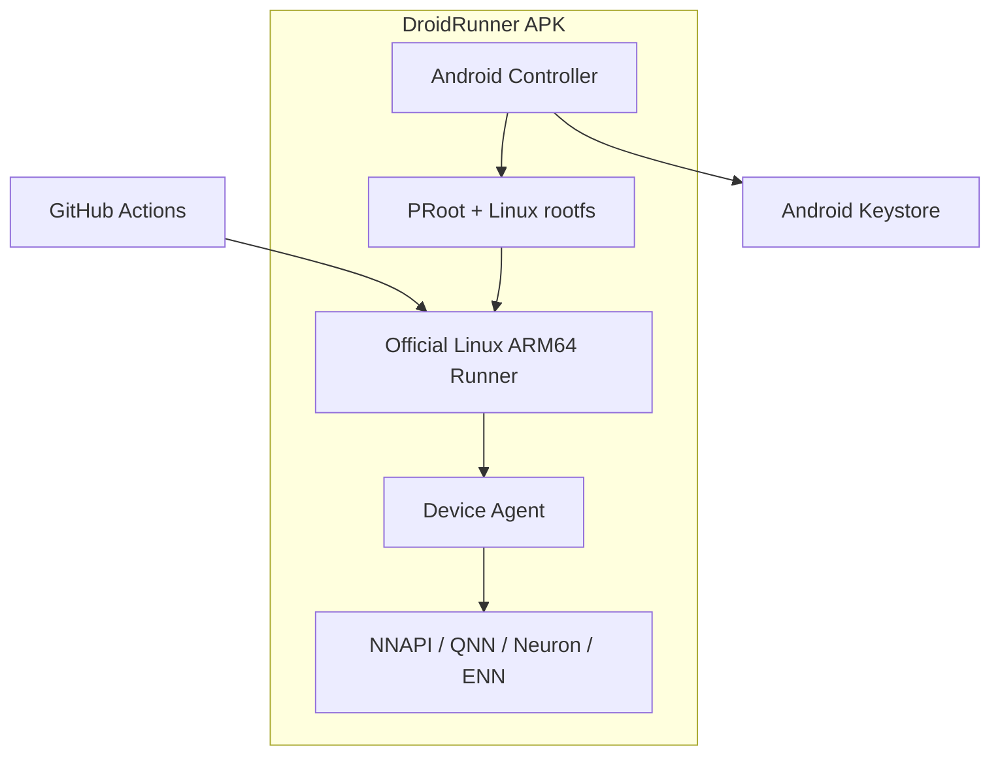

# DroidRunner

**Turn your sleeping Android devices into real-hardware GitHub Actions runners.**

[日本語版 README はこちら](README.ja.md)

**[Site and tutorial](https://droidrunner.m96-chan.dev/)** — what it is, what it looks like, and a step-by-step device setup.

DroidRunner is an Android app that runs an ARM64 Android device as a repository-scoped
GitHub Actions self-hosted runner.

No Termux, no root, no permanent USB connection to a PC. The APK manages a Linux
execution environment and the installation, registration, and background operation of
the official GitHub Actions Runner.

Beyond ordinary ARM64 builds, a job can hand the device a `.tflite` model and get
latency back from the actual accelerator — 0.65 ms on a Tensor G4's EdgeTPU where
the same phone's CPU takes 141 ms. That is the measurement a virtual ARM64 runner
cannot produce, and the reason this exists.

> [!WARNING]
> A self-hosted runner executes whatever code a workflow contains, on your phone.
> Use a device dedicated to CI, and never let it pick up pull requests from forks
> of a public repository. Qualcomm NPUs need an opt-in, because reaching them means
> accepting Qualcomm's terms; MediaTek and Google Tensor work out of the box.

## Goals

- Reuse spare phones and tablets as ARM64 build capacity
- Verify real-hardware differences across Qualcomm, Google Tensor, MediaTek, and Exynos from GitHub Actions
- Classify multiple devices with labels and route jobs to the SoC or NPU they need
- Complete installation, updates, and monitoring with nothing but the Android app
- Accept jobs safely with battery, charging, and thermal state in mind

## Features

- **Single APK** — no Termux or other companion app required
- **No root** — runs a Linux ARM64 environment on top of PRoot
- **Official runner** — uses GitHub's official Linux ARM64 Actions Runner
- **Repository or organization scope** — serve one repository, or every repository in an organization from a single device
- **GitHub App login** — device-flow sign-in with a repository picker; no manual PAT handling
- **Automatic device classification** — generates runner labels from Android API level, SoC, and what the accelerators actually answer
- **Safe credential handling** — encrypts the PAT with the Android Keystore
- **Background standby** — keeps the runner alive with a Foreground Service and a wake lock
- **Tamper detection** — verifies the runtime bundle's SHA-256 before extracting it
- **btop-style dashboard** — live CPU, memory, battery, thermal, disk, and network monitor together with runner status
- **Self-protecting** — holds jobs while the device is low on battery, hot, or short on space, and restarts the listener on its own after a failure. A power cut alone does not stop a charged phone: the battery carries it until the level actually falls. A held device really does go offline to GitHub, rather than only believing it has. A hold is not counted as a crash, so the device comes straight back when the condition clears instead of serving out a backoff it never earned ([#210](https://github.com/m96-chan/DroidRunner/issues/210))
- **Says what it is doing** — the notification carries the runner state and, when work is held, the reason; a picture-in-picture window keeps it on screen while the phone is used for something else
- **Hands over its own log** — the device report and the tail of the runner log, on the clipboard. A release build refuses `run-as`, so this is the only way a phone that is not yours can say what happened to it
- **Ephemeral mode** — optionally re-registers and wipes the work directory after every job
- **Usable from another repository** — a composite action, a documented result contract, and exit statuses that tell a refusal apart from a phone that stopped answering

## Architecture overview



Ordinary shells, Git, Node.js, Python, Rust, Go, Gradle, and so on run inside PRoot.
Tests that need Android APIs or the NPU are delegated to the Device Agent inside the
APK through a loopback API.

## Dashboard

The app's main screen is a btop-inspired terminal dashboard rendered with Jetpack
Compose:


- **cpu** — load history graph plus per-core meters with current frequency
  (per-core load uses `/proc/stat` deltas where readable, otherwise the scaling
  frequency relative to each core's maximum)
- **mem / disk** — usage meters and history for RAM and app-private storage
- **pwr/net** — battery level and charging state, battery temperature, Android thermal
  status, and network throughput
- **runner** — runner state (stopped / starting / listening / running job), registered
  repository, uptime, succeeded and failed job counts, how long the device stayed
  offline after a reboot that left it locked, and a live tail of the runner log
- **setup** — a separate screen (⚙) with GitHub sign-in, repository picker, runtime
  install, registration, and the job policy (charging / battery / thermal / storage
  thresholds, ephemeral mode, start-on-boot); a registered runner starts automatically
  on app launch

The runner state is parsed from the official runner's listener output by the foreground
service and streamed to the UI as a `StateFlow`.

## What it does

Everything below runs on real phones — the fleet this is developed against is a
MediaTek MT6899, a Google Tensor G4, and two Snapdragons.

**Running CI**

- Registers as a repository or organization runner from the app, via GitHub App
  device flow — no PAT to create by hand, and the token never enters the Linux side
- Runs the official `linux-arm64` Actions runner under PRoot, with proot shipped
  inside the APK because Android 10+ will not `exec()` from app storage
- Holds jobs while the device is low on battery, hot or short on space, and takes
  them again when it recovers. Mains power going away is not enough on its own —
  a charged phone keeps working through it. A held device really does go offline to GitHub,
  and comes back the moment the condition clears: a hold is the design working,
  not a failure to count against the runner
- Restarts a listener that dies, backing off if it keeps dying, and alerts once
  rather than once per attempt. A pass of the supervisor that throws — a storage
  reading that failed, a fork refused under memory pressure — is slept off and
  retried, rather than ending the runner until the watchdog notices
- Ephemeral mode re-registers and wipes the work directory per job

**Running models on the silicon**

- A job hands the device a `.tflite` file and gets latency back, per NNAPI driver
- Labels are probe-verified — `nnapi-accelerator` means an accelerator answered,
  not that the SoC name looked promising — and are corrected on GitHub when the
  device disagrees with what it registered
- The Device Agent is reached over loopback with a token minted per job

**Staying honest about itself**

- btop-style dashboard, a notification carrying the runner state and the reason
  jobs are held, and a picture-in-picture window for watching it elsewhere
- Runtime manifests are ECDSA-signed and verified against keys compiled into the
  APK; an install that fails leaves the previous runtime in place
- The log keeps its history across restarts and records the app's own decisions
  next to the runner's output

**Not yet**

| | |
| --- | --- |
| MediaTek Neuron | [#83](https://github.com/m96-chan/DroidRunner/issues/83) — blocked: the public runtime takes `.dla` and nobody can produce one. NNAPI still reaches this hardware |
| Android 9 | [#146](https://github.com/m96-chan/DroidRunner/issues/146) — the declared floor, never run on a device that old. Nobody in this pool owns one |
| Qualcomm's older DSP | [#147](https://github.com/m96-chan/DroidRunner/issues/147) — one Hexagon generation, V66, and no handset from it |
| The cost of an engine boundary | [#159](https://github.com/m96-chan/DroidRunner/issues/159) — two delegates can be named as an experiment; the measurement needs a phone whose NPU is in-process |

The [roadmap](#roadmap) is the full list; this is the short one, and it is the
short one that drifted — it went on calling the fleet view and runtime updates
unbuilt after both had shipped.

## Runner labels

In addition to the standard labels the official runner adds, DroidRunner uses these
custom labels.

| Label | Meaning |
| --- | --- |
| `android` | Physical Android device running DroidRunner |
| `arm64` | ARM64 device |
| `android-api-N` | Android API level |
| `soc-*` | Detected SoC information |
| `nnapi` | NNAPI is usable on this device |
| `nnapi-accelerator` | **An accelerator answered the probe** — the label to select on for model work |
| `android-npu` | The SoC family is known to have an NPU. A hint, not a promise |
| `npu-qnn` | **A model has run on this phone's Hexagon** — measured, not guessed |
| `npu-tflite` | Google Tensor / LiteRT candidate |
| `npu-neuron` | MediaTek Neuron candidate |
| `npu-enn` | Samsung ENN candidate |

`npu-tflite`, `npu-neuron` and `npu-enn` come from the SoC name and are **hints**;
`nnapi`, `nnapi-accelerator` and `npu-qnn` come from asking the device and are
measurements. Hints and measurements can disagree, so select on a measurement when a
job needs acceleration or it may quietly get a CPU.

Qualcomm is the case where they disagreed most. Those phones have a Hexagon that
NNAPI cannot reach at all — Qualcomm ships no NNAPI driver, and a Snapdragon
enumerates only `nnapi-reference`, the CPU. `npu-qnn` used to come from the SoC name,
so a job selecting it landed on a device that ran everything on its CPU and said
nothing. It is now emitted only after a model has demonstrably executed on the
Hexagon, which needs the opt-in below.

Labels are recomputed when the app starts and corrected on GitHub if they have
drifted — they used to be frozen at registration, which left one phone announcing
what a much older build believed about it.

### Qualcomm NPU: opt in first

The Hexagon needs Qualcomm's own runtime, which DroidRunner fetches rather than
ships. On a Snapdragon the setup screen offers it:

1. **Review Qualcomm's terms.** Two licences, from two Qualcomm entities, with
   field-of-use restrictions that bind whoever runs the device — so they are yours
   to accept, not ours. The documents are fetched and opened in a PDF reader; what
   is recorded is their digests, so terms that change ask again and a release that
   leaves them alone does not.
2. **Install.** 38MB to download, 102MB on disk, and only the Hexagon generation
   this phone has.
3. **Check the NPU.** Runs a model and reports the split — `all 64 operators on the
   Hexagon, 1.24ms`. Only this earns `npu-qnn`.

Nothing is fetched before step 1, and a phone that never opts in behaves exactly as
before. Devices without a Snapdragon never see the panel.

Measured on a nubia NX769J (Snapdragon 8 Gen 3), EfficientNet-Lite0:

| model | route | median |
| --- | --- | --- |
| int8 | `nnapi-reference` (NNAPI's only option here) | 113.2 ms |
| int8 | CPU | 4.46 ms |
| int8 | **Hexagon** | **1.22 ms** |
| int8 | Adreno, through TFLite's GPU delegate | 4.95 ms |
| float32 | `nnapi-reference` | 39.8 ms |
| float32 | **Hexagon** | **2.78 ms** |

A job asking for `qnn-htp` is refused rather than quietly run on the CPU:
`droidrunner-device test model x.tflite --device qnn-htp` fails unless the delegate
says how much of the graph it took.

### The GPU, which every phone has

`--device gpu` reaches TFLite's own GPU delegate. Not the fastest route on any
phone here — the Hexagon is four times quicker — but it is the only accelerator
present on **every** device, including the ones whose vendor ships no NNAPI
driver, and it is the one where precision is a **declared choice** rather than a
discovery:

| path to the same Adreno | EfficientNet-Lite0 int8 |
| --- | --- |
| `gpu` — TFLite's delegate, OpenCL | all 64 operators, 4.95 ms, full precision |
| `qnn-gpu` — Qualcomm's own GPU backend | refuses at graph finalize, error 6020 |

One piece of silicon, two vendors' software, one of which will run the model.

That declared precision is worth something. On the same phone, given f32 inputs
whose exact sums are representable, the GPU asked for full precision returns
**1024 of 1024 bit-exact**, and the Hexagon returns 1016 of 1024 off by one ULP
because it computed in fp16 without being asked. See
[`tools/ulp/README.md`](tools/ulp/README.md).

TFLite's own compatibility list says this phone is **not** supported, which is
why nothing gates on it: the list ships inside the library and predates the
handset. `capabilities` reports it as `allowlisted` — advisory, and the delegate
is asked regardless.

## Example workflows

### Run on any Android device

```yaml
name: Android device test

on:
  workflow_dispatch:

permissions:
  contents: read

jobs:
  test:
    runs-on: [self-hosted, android, arm64]
    steps:
      - uses: actions/checkout@v4
      - run: uname -a
      - run: ./ci/test-arm64.sh
```

### Ask the silicon a question

```yaml
jobs:
  npu:
    runs-on: [self-hosted, android, nnapi-accelerator]
    steps:
      - run: droidrunner-device capabilities                 # device, thermal, drivers
      - run: droidrunner-device devices                      # what NNAPI exposes here
      - run: droidrunner-device test model my-model.tflite --device google-edgetpu --iterations 30
```

`droidrunner-device` is installed into the guest from the APK on every start, so
it stays in step with the agent it talks to.

### Verifying a model, not just timing it

Latency says a graph was *accepted*. Whether it was computed *correctly* is a
different question, and the one a compiler cares about — a lowering bug that only
appears on the vendor's silicon looks exactly like a working compiler when the
check runs on an x86 reference.

```yaml
      - uses: m96-chan/DroidRunner/actions/run-model@main
        id: device
        with:
          model: build/model.tflite
          device: qnn-htp
          inputs: fixtures/input-0.bin      # raw, little-endian, one file per tensor
          output-dir: out
      - run: test "${{ steps.device.outputs.executed }}" = accelerator
      - run: cmp out/output-0.bin fixtures/golden-0.bin
```

That is a differential test between a vendor's NPU and a reference implementation,
running on push — which no cloud runner can do at all. Outputs come back with their
quantization parameters, so int8 bytes do not have to be reverse-engineered into
numbers.

### Sweeps, for when the unit of work is not one model

A few hundred single-op models is a few hundred workflow steps otherwise, which is
the expensive part:

```sh
droidrunner-device test batch manifest.json --output sweep.json
```

One entry back per entry sent, in order. A failing row never ends the sweep — a
sweep is largely *made of* rejections, and each one is the data. `iterations: 0`
means load, delegate and allocate but do not time, for the rows that only ask
whether a graph was accepted. A row that also names an `outputDir` is run once
anyway, untimed: a file under `outputFiles` only ever holds what an invocation
produced.

That sweep has a workflow of its own: **Operator support matrix** builds one
model per operator and precision, runs every one on every driver the phone
exposes, and prints which operators were taken and which were not. A whole
network cannot answer that — one refused node pushes its entire partition back
to the CPU, so a fallback says a table is wrong somewhere without saying where.
Every model is also run with no device at all, so a model that is simply broken
is excluded rather than filed as an operator some driver refuses. See
[`docs/OPERATOR-MATRIX.md`](docs/OPERATOR-MATRIX.md) for what a cell claims, and
the rather longer list of what it does not.

### What another repository pins to

[`docs/RESULT-CONTRACT.md`](docs/RESULT-CONTRACT.md) — a `schema` on every response,
a `code` from a closed set when something fails, and wrapper exit statuses that
separate the cases a sweep must treat differently:

| exit | meaning |
| --- | --- |
| `0` | it ran |
| `1` | yours to fix — a model nothing can load, inputs that do not fit it, or an option value that cannot go in a request |
| `2` | the driver refused the graph — record it and carry on |
| `3` | no such device on this phone |
| `4` | the agent is unreachable — stop |
| `5` | the phone is busy and attempted nothing — wait and send the same request again |

The prose in `error` is for a person and gets reworded; the code is for a program
and does not.

A timed result also says **what the phone was doing while it was measured** —
thermal status, headroom, battery temperature, charging and screen at each end
of the loop, plus `p90Us`/`p99Us` and a blunt `conditions.stable`. A regression
gate that fails a build because the phone was warm gets muted inside a week, and
then the real regressions arrive unnoticed.

#### What that actually tells you

EfficientNet-Lite0, median of 30 runs (int8) and 20 (float32), same model and the
same harness on both phones:

| device | driver | int8 | float32 |
| --- | --- | --- | --- |
| Tensor G4 | `google-edgetpu` | **0.65 ms** | 16.7 ms |
| SM8650 | `qnn-htp` (Hexagon) | 1.22 ms | **2.78 ms** |
| MT6899 | `mtk-neuron_shim` | 2.12 ms | 7.29 ms |
| MT6899 | `mtk-mdla_shim` | 2.69 ms | *fell back to the CPU* |
| Tensor G4 | *NNAPI's own choice* | 5.65 ms | — |
| MT6899 | `mtk-dsp_shim` | *fell back to the CPU* | *fell back to the CPU* |
| SM8650 | `nnapi-reference` (CPU) | 113 ms | 39.8 ms |
| Tensor G4 | `nnapi-reference` (CPU) | 141 ms | 64.1 ms |
| MT6899 | `nnapi-reference` (CPU) | 257 ms | 106 ms |

Four things a spec sheet would not have told you:

- **The winner changes with the quantization, across vendors.** EdgeTPU takes int8;
  the Hexagon takes float32 by 2.6× over its nearest rival. Neither phone is "the
  fast one" — it depends on the model you ship.
- **Some of those cells are not measurements of the accelerator at all.** An earlier
  version of this table gave MediaTek's MDLA a float32 number. It never ran there:
  the driver refused the graph and the CPU picked it up. Every run now reports
  [who executed it](docs/RESULT-CONTRACT.md#executed--the-field-most-consumers-branch-on),
  and a fallback says so instead of arriving as a plausible number.
- **Quantizing can decide whether an accelerator is reachable at all**, not just how
  fast it is: MediaTek's MDLA takes int8 and refuses float32 outright.
- **Letting NNAPI choose costs most of the speedup**, and NNAPI cannot reach a
  Hexagon at all — a Snapdragon enumerates only its CPU, which is why that row needs
  the opt-in above.

This is the question a device pool exists to answer, and a virtual ARM64 runner
cannot answer it at all.

## Requirements

### Android device

- ARM64 (`arm64-v8a`)
- Android 9 / API 28 or later
- A few GB of free storage
- A stable network connection
- A charger and some form of cooling are recommended for long-running operation

32-bit ARM, x86 Android, Docker, KVM, and nested virtualization are not supported.

### Install

Releases are published to [GitHub Releases](https://github.com/m96-chan/DroidRunner/releases)
as `droidrunner-v<version>.apk` (arm64 only).

**With [Obtainium](https://github.com/ImranR98/Obtainium)** — recommended, since an
unattended runner should not wait for someone to notice a release:

1. Add app → paste `https://github.com/m96-chan/DroidRunner`
2. APK filter — `droidrunner-v.*\.apk`. Not optional: every release also carries
   the corresponding-source archive `droidrunner-v<version>-source.tar.gz`, and
   without the filter Obtainium has two assets to choose between

Obtainium then updates the app in place as new tags are published.

**By hand**: download the APK from the latest release and install it.

> [!NOTE]
> Updates install over the existing app only while the signing key stays the same.
> Reinstalling from a differently signed source — your own build, say — requires
> uninstalling first, which discards the runner registration and the stored GitHub
> credentials, so you would have to register the device again.

Google Play is not a distribution target: the app exists to execute code fetched from
outside the store, which runs into the Device & Network Abuse policy on dynamic code
execution.

F-Droid is not one either. Its promise is that everything running on your device was
built from source, and this app cannot honour it: on first setup it downloads a
~200MB Ubuntu rootfs and GitHub's prebuilt runner, and then executes whatever a
workflow contains. Building the APK from source would guarantee the least dangerous
part of what actually runs. Releases here, or Obtainium, serve the same people
without that mismatch.

## Build environment

- JDK 17
- Android SDK 35
- Android Studio (any version supporting AGP 9.4); Gradle comes from the wrapper

## Build

```bash
git clone <repository-url>
cd DroidRunner
ANDROID_NDK_ROOT=$ANDROID_HOME/ndk/<version> runtime/build-proot.sh
./gradlew assembleDebug
```

`build-proot.sh` cross-compiles proot with the NDK into `app/src/main/jniLibs/`
(required once — Android 10+ can only exec binaries shipped inside the APK).

Resulting APK:

```text
app/build/outputs/apk/debug/app-debug.apk
```

This repository also contains a GitHub Actions build definition.

### Publishing a release

Pushing a `v*` tag builds and publishes the APK. `versionName` and `versionCode` are
derived from the tag, so an update always outranks the version it replaces; a local
build without a tag reports `0.0.0-dev`.

The tag must be exactly `v<major>.<minor>.<patch>`. Anything else — an `-rc1` suffix,
say — does not match the regex the build reads, so `versionName` falls back to
`0.0.0-dev` and `versionCode` to 1: a release installed as a development build, which
can never be upgraded from. The workflow refuses such a tag before the keystore is
anywhere near the runner. It can also be dispatched by hand with a tag, and it builds
that tag's commit rather than whatever branch dispatched it. Publication refuses a tag
that already has a release rather than overwriting its APK — publish changed code under
a new version ([#252](https://github.com/m96-chan/DroidRunner/issues/252)). Each
release carries two assets: the APK and the corresponding-source archive
`droidrunner-v<version>-source.tar.gz`.

Releases must be signed with a stable key, and the build refuses to produce a tagged
release with the debug key. Create one keystore, keep it safe, and store it in the
repository secrets:

```bash
keytool -genkey -v -keystore release.jks -alias droidrunner \
    -keyalg RSA -keysize 4096 -validity 10000
base64 -w0 release.jks   # → ANDROID_KEYSTORE_BASE64
```

Secrets: `ANDROID_KEYSTORE_BASE64`, `ANDROID_KEYSTORE_PASSWORD`, `ANDROID_KEY_ALIAS`,
`ANDROID_KEY_PASSWORD`. Losing the key means users have to uninstall and re-register
their devices to move to a new one.

## Setup

1. Install the DroidRunner APK on the device
2. Tap **Connect GitHub** on the setup screen — an 8-character code is shown (and
   copied to the clipboard); enter it at `github.com/login/device` and approve
3. If the DroidRunner GitHub App is not installed on any of your repositories, the app
   prompts you to install it — install it on the repository this runner should serve
4. Choose the **scope** — a single repository, or an organization the app is
   installed on — pick the target, and tap **Register** . The runtime bundle
   (~200MB) is discovered from the newest `runtime-*` GitHub Release and installed
   automatically

   > [!WARNING]
   > An organization runner accepts jobs from **every repository in the
   > organization** unless you place it in a [runner group](https://docs.github.com/en/actions/hosting-your-own-runners/managing-self-hosted-runners/managing-access-to-self-hosted-runners-using-groups)
   > with an allow-list. On a device that executes workflow code, that is a
   > materially wider trust boundary than repository scope — the repository
   > default exists for a reason.

   Changing the target later is possible: stop the runner, pick the new target,
   and the button offers **Re-register**.
5. Done — the runner starts automatically whenever the app launches
   (Start/Stop controls live in the dashboard's runner panel)

   **Stop** returns at once and the runner reads *stopping* until it is down. It
   takes up to about half a minute, nearly all of it waiting for the listener to
   hand its session back to GitHub — which is what saves the next start minutes
   of "a session for this runner already exists". Waiting it out is the point;
   the app no longer waits with you.

The app resolves the runtime from the repository named by the
`droidrunner.runtimeRepo` build property. That repository publishes app and
runtime releases to one list, so the list is read page by page until a
`runtime-*` release turns up: the bundle stays findable however many app
releases were published after it. A manual manifest URL override lives under
`advanced` for GitHub Enterprise Server or self-hosted bundles. Maintainers
publish new bundles with the **Runtime bundle** workflow (see `runtime/README.md`).

The runtime panel tells the three outcomes of that lookup apart: a release was
found, this repository publishes none, or GitHub could not be reached. Only the
last one is a bad minute rather than a configuration to change, and it is the
one that offers **Retry** — the others send you to `advanced`.

The repository picker lists every installation the app is on — all of them, not
just the first hundred — and up to 500 repositories per installation.

Sign-in uses the GitHub App device flow, so no client secret is embedded in the APK
and no PAT has to be created by hand. The user token is encrypted with the Android
Keystore and never enters the Linux environment; the controller exchanges it for a
short-lived registration token. The refresh token is stored the same way, and the
sign-in is renewed before it expires (and again if GitHub rejects a token anyway),
so an ephemeral device keeps re-registering without anyone opening the app. If a
renewal is refused, the device says so in a notification: that one does need a
person.

A manual fallback (`advanced: manual PAT setup`) accepts a fine-grained PAT with the
repository Administration read/write permission, for GitHub Enterprise Server or
builds without a GitHub App. The PAT typed there is the credential that registers,
whether or not a GitHub sign-in is also active — so it is also the way to reach a
repository the App is not installed on, with no need to disconnect first.

Leaving the repository the device is already in is a separate question, and is
answered separately: that PAT is scoped to the repository being *joined*, so
when the old one refuses it the stored sign-in is tried instead. If neither can
reach the old target the registration still goes ahead, and the status line
names the repository that still holds an entry for you to remove by hand. Like
**Re-register** above it, it waits for the runner to be stopped: registering
rewrites the identity files a running listener is holding open.

### GitHub App registration (for self-builders)

The device flow needs a GitHub App identity. Register one once (free, no server
required):

1. GitHub → Settings → Developer settings → **New GitHub App**
2. Repository permission **Administration: Read and write**; no webhook
3. Enable **Device flow**
4. Optional: opt out of user access token expiration (Optional features). The app
   now stores the refresh token and renews the sign-in before it lapses, so this is
   advice for a quieter setup rather than something the app depends on
5. Put the public identifiers into `gradle.properties`:

```properties
droidrunner.githubAppClientId=Iv1.xxxxxxxxxxxxxxxx
droidrunner.githubAppSlug=your-app-slug
```

Without these values the app hides the GitHub login and offers only the manual PAT
setup.

## Runtime bundle

The Linux environment is not embedded in the APK; it is downloaded during first-time
setup. This keeps the APK small and lets the rootfs and the official runner update
independently of the APK. No companion app is needed.

proot itself ships **inside the APK** as jniLibs and is executed from
`nativeLibraryDir`, because Android 10+ refuses to `exec()` binaries stored in app
data. The downloaded bundle is therefore data only:

```text
bundle/
├── rootfs/            Ubuntu ARM64 base + runner dependencies
│   ├── bin/
│   └── usr/
└── home/
    └── runner/        official Actions runner (linux-arm64)
        ├── config.sh
        ├── run.sh
        └── bin/Runner.Listener
```

The **Runtime bundle** CI workflow builds and publishes this to a GitHub Release
together with a matching manifest:

```json
{
  "version": "runner-2.337.0-ubuntu-24.04.3+runtime-0.1.0",
  "url": "https://github.com/OWNER/DroidRunner/releases/download/runtime-0.1.0/droidrunner-runtime-arm64.tar.gz",
  "sha256": "..."
}
```

The SHA-256 proves the archive matches the manifest. It says nothing about who wrote
the manifest — and whoever can replace a manifest can point devices at a rootfs of
their choosing, which is where CI jobs execute. So the manifest is signed too, and the
app verifies it against public keys compiled into the APK before anything is
downloaded.

Generate a signing key once, keep it safe, and put the private key in the repository
secret `RUNTIME_SIGNING_KEY`:

```bash
openssl ecparam -genkey -name prime256v1 -noout -out runtime-signing.pem
openssl ec -in runtime-signing.pem -pubout -outform DER | base64 -w0
```

Put that public key in `gradle.properties`:

```properties
droidrunner.runtimeSigningKeys=MFkwEwYHKoZIzj0CAQYIKoZIzj0DAQcDQgAE...
```

Several keys can be trusted at once, comma-separated, so a key can be rotated: ship the
new one in a release, sign with either while both are trusted, then drop the old one.

A build with no key configured cannot verify anything and says so during install rather
than pretending otherwise; a build that *does* carry a key refuses an unsigned or
wrongly signed manifest.

## NPU Device Agent

A Linux process inside PRoot cannot call Android's NNAPI or vendor Java APIs directly.
NPU tests therefore cross this boundary:

```text
GitHub job
  └─ droidrunner-device CLI
      └─ 127.0.0.1 + job capability token
          └─ isolated Android Service
              └─ NNAPI / QNN / Neuron / ENN adapter
```

The design never loads arbitrary `.so` files into the controller. Approved adapters run
in an isolated service and accept only test requests with explicit models, inputs,
timeouts, and output destinations.

See [`docs/ARCHITECTURE.md`](docs/ARCHITECTURE.md) for the detailed design.

## Security

A self-hosted runner executes whatever code the workflow contains, on your device.

- Never auto-run pull requests from forks of public repositories
- Minimize repository and PAT permissions
- Do not casually combine `pull_request_target` with self-hosted runners
- Use devices wiped and dedicated to CI, not devices in personal use
- Keep secrets out of the runner work directory
- Enable ephemeral runners, which re-register and wipe the work directory after each job

PRoot is a compatibility layer, not a strong security boundary like Docker or a VM.

## Limitations

- Docker-based actions and service containers are not available
- PRoot's syscall translation adds overhead
- Android battery optimization and vendor task killers can interfere. The runner is
  restarted by a persisted `JobScheduler` watchdog if the system kills it, which was
  measured to bring a killed runner back within one 15-minute period on a Xiaomi
  2511FPC34G. **Some ROMs defeat every mechanism available to an app.** On a RedMagic 8
  (ZTE), a killed runner is never restarted: not by `START_STICKY`, not by an alarm, and
  not by the watchdog job with every constraint satisfied and half an hour to run in —
  with the app exempt from battery optimization, in the EXEMPTED standby bucket, not
  background-restricted and not dozing. The vendor's per-app power screen is behind a
  signature permission, so the app cannot even open it for you; it has to be granted by
  hand in the phone's own settings
  ([#184](https://github.com/m96-chan/DroidRunner/issues/184)).
  A watchdog tick writes a line only when it actually found the runner down, so
  `watchdog (job): the runner was not running` in the log means a real recovery
  and is worth counting ([#214](https://github.com/m96-chan/DroidRunner/issues/214))
- Start-on-boot resumes the runner once the device is **unlocked**, not when it boots:
  Android holds `BOOT_COMPLETED` back while the user is credential-locked, and the
  runtime bundle and the stored credentials sit in credential-encrypted storage that is
  unreadable until first unlock. A device dedicated to CI should therefore have no
  secure lock screen — otherwise a power cut takes CI down until someone picks the
  phone up. The dashboard reports how long a boot went unserved
  ([#41](https://github.com/m96-chan/DroidRunner/issues/41))
- **An organisation with more than 100 registered runners** is more than this app
  looks at. Reconciling this device's labels means finding its own runner by name,
  and that search reads a single page of 100 — so on a larger org the phone is not
  on the page, its labels reconcile against nothing, and it neither errors nor says
  so. Repository-scoped runners are unaffected, and so is every org below the
  threshold. Known and not fixed
  ([#230](https://github.com/m96-chan/DroidRunner/issues/230))
- **Per-core CPU usage is unavailable on many phones.** Android restricts
  `/proc/stat`, and where the app cannot read it no core can be measured: the
  dashboard marks each core with the clock it is running at (`~902MHz`) instead,
  and the average reads `--` rather than a load nobody measured
  ([#239](https://github.com/m96-chan/DroidRunner/issues/239)). Confirmed
  unreadable on a nubia NX769J running Android 16
- Android 12+ restricts how foreground services may be started
- Some actions do not support ARM64 or a Linux environment on Android
- The rootfs and build caches can consume significant storage

## Roadmap

- [x] Stabilize the runtime bootstrap on real devices, following GABE
- [x] Job admission control based on battery, thermal, and free storage, holding only
      once the phone is spending its own charge below the floor
      ([#185](https://github.com/m96-chan/DroidRunner/issues/185)) — a power cut no
      longer stops a charged device
- [x] Listener crash recovery with restart backoff, telling a crash apart from a
      stop the supervisor asked for
      ([#210](https://github.com/m96-chan/DroidRunner/issues/210)) — a hold no
      longer raises "not staying up" or delays the return by minutes
- [x] A stop that does not freeze the app for the twenty seconds it takes
      ([#209](https://github.com/m96-chan/DroidRunner/issues/209))
- [x] A supervisor that survives a transient error instead of ending the runner
      with a dashboard that reads exactly like the Stop button
      ([#211](https://github.com/m96-chan/DroidRunner/issues/211))
- [x] Restart the runner after the system itself kills the service
      ([#184](https://github.com/m96-chan/DroidRunner/issues/184)) — `START_STICKY`
      plus a deadline-bound watchdog job, because each was measured failing alone;
      some vendor ROMs defeat both, which the Limitations section names
- [x] Ephemeral runners with post-job cleanup
- [x] Organization-scoped runners (one device serving a whole organization)
- [x] Device Agent with per-job capability tokens
- [x] NNAPI capability probe and smoke test — run on every CI build against a real device
- [x] Run a caller-supplied model rather than the built-in benchmarks
- [x] Reach Qualcomm NPUs, which NNAPI cannot ([#82](https://github.com/m96-chan/DroidRunner/issues/82)) — 1.22ms against the CPU's 4.46ms
- [x] Run a caller-supplied model's own inputs and return its outputs ([#92](https://github.com/m96-chan/DroidRunner/issues/92))
- [x] Report which driver actually ran the graph, not which one was asked for ([#93](https://github.com/m96-chan/DroidRunner/issues/93))
- [x] A documented result contract and a composite action other repositories can use ([#95](https://github.com/m96-chan/DroidRunner/issues/95))
- [x] Run a manifest of models in one request ([#94](https://github.com/m96-chan/DroidRunner/issues/94))
- [ ] MediaTek Neuron — blocked: the public runtime takes `.dla` and nobody can produce one ([#83](https://github.com/m96-chan/DroidRunner/issues/83))
- [x] An operator support matrix measured on silicon rather than read off a datasheet ([#96](https://github.com/m96-chan/DroidRunner/issues/96)) — three MediaTek drivers disagree on one SoC
- [x] Say what state the device was in when a number was measured ([#98](https://github.com/m96-chan/DroidRunner/issues/98))
- [x] Compare a matrix against the last one, so a driver that stops taking an operator is a red build ([#126](https://github.com/m96-chan/DroidRunner/issues/126))
- [x] Fail the build when TFLite stops printing what the delegation report is parsed from ([#128](https://github.com/m96-chan/DroidRunner/issues/128))
- [x] Test the `droidrunner-device` wrapper every consumer goes through ([#125](https://github.com/m96-chan/DroidRunner/issues/125))
- [x] One command to put a build on every attached phone ([#127](https://github.com/m96-chan/DroidRunner/issues/127))
- [x] Reach the GPU, the one accelerator every phone has ([#140](https://github.com/m96-chan/DroidRunner/issues/140)) — 4.95 ms on an Adreno, and bit-exact f32
- [x] One shape for a failure, whichever layer produced it ([#138](https://github.com/m96-chan/DroidRunner/issues/138))
- [ ] Samsung Exynos — deprioritised: few devices, and those that exist are either
      flagship-priced or bargain oddities, so a test phone is hard to justify
- [ ] Qualcomm's older Hexagon DSP — parked: the published runtime covers exactly
      V66, and no Snapdragon 855-class device is on hand to verify it on
      ([#147](https://github.com/m96-chan/DroidRunner/issues/147))
- [x] Runtime manifest signature verification
- [x] Notification carrying the runner state, the hold reason, and alerts for what GitHub cannot see
- [x] Picture-in-picture window for watching a runner while using the phone
- [x] Report how long a reboot left the device unserved because it was locked ([#41](https://github.com/m96-chan/DroidRunner/issues/41))
- [x] Reinstall a missing runtime without re-registering, and never leave a device with none
- [x] Renew the GitHub sign-in instead of losing it when the token expires
- [x] Stop holding jobs for a condition that lasts one sample
- [x] Skip unreadable entries in GitHub responses rather than losing the whole list
- [x] Notify or auto-install when the runtime bundle is out of date ([#14](https://github.com/m96-chan/DroidRunner/issues/14))
- [x] Say why a delegate declined, not only who ran the graph
      ([#158](https://github.com/m96-chan/DroidRunner/issues/158)) — **answered, not
      built**: TFLite ships XNNPACK's per-node reasons and no NNAPI equivalent, so
      nothing here can know why an NNAPI driver refused, and the contract says so
      with the evidence
- [ ] Measure what crossing between two engines costs
      ([#159](https://github.com/m96-chan/DroidRunner/issues/159)) — the vocabulary
      is in, as an experiment; the measurement needs a phone whose NPU is an
      in-process delegate
- [ ] Android 9 — the declared floor since the first commit, and never once run on a
      device that old ([#146](https://github.com/m96-chan/DroidRunner/issues/146))
- [x] Fleet dashboard showing the state of multiple devices ([#7](https://github.com/m96-chan/DroidRunner/issues/7))
      — `tools/fleet.sh`, the read-only half: it joins GitHub's runner state with
      what the devices say about themselves, and needs no new infrastructure
- [x] Ship the corresponding source for the GPL binaries we distribute ([#116](https://github.com/m96-chan/DroidRunner/issues/116))

## Related projects

- [GitHub Actions Runner](https://github.com/actions/runner)
- [Godot Android Editor Build Environment (GABE)](https://github.com/godotengine/android-editor-buildenv-app)
- [PRoot](https://github.com/termux/proot)
- [UserLAnd](https://github.com/CypherpunkArmory/UserLAnd)

DroidRunner is heavily inspired by GABE, in particular its design of managing a PRoot
environment from an Android service.

## License

DroidRunner is released under the **GNU General Public License v2.0 only
(`GPL-2.0-only`)** — see [`LICENSE`](LICENSE).

The APK and the runtime bundle also carry third-party components under their
own licenses:

| Component | License | Corresponding source |
| --- | --- | --- |
| [PRoot](https://github.com/termux/proot) (`libproot.so`, loaders) | GPL-2.0 | source ships beside every release as `droidrunner-<tag>-source.tar.gz`; commit pinned in [`runtime/build-proot.sh`](runtime/build-proot.sh), patches in [`runtime/patches/`](runtime/patches) |
| [talloc](https://talloc.samba.org/) (statically linked into proot) | LGPL-3.0 | in the same archive, with the script to rebuild and relink |
| The runtime bundle's Ubuntu rootfs | GPL / LGPL / various | `PACKAGES.txt` and `SOURCE-OFFER.txt` inside the bundle name every package and version, and how to get its source |

The runtime bundle carries more: the [GitHub Actions Runner](https://github.com/actions/runner)
(MIT) and an Ubuntu rootfs whose packages keep their own licenses. If you distribute a
bundle, provide the corresponding sources, patches, build instructions, and copyright
notices along with it — `runtime/build-bundle.sh` pins exactly what goes in.

The app's About screen makes the same offer on the device: it names
`droidrunner-<tag>-source.tar.gz` for the release that build came from and
links to it, points at `PACKAGES.txt` and `SOURCE-OFFER.txt` for the rootfs,
and says plainly when a development build has no release behind it.
`tools/check-licence-tables-match.sh` fails the build if a component in this
table is missing from that screen.

## FM device investigation: dpkg `status-old` permission error (2026-11-26)

This section records a read-only investigation on the FM fork and an Android 13
ZTE Z2352N device. It is diagnostic history, **not a confirmed fix**.

### Observed failure

Inside the Ubuntu 24.04 ARM64 PRoot environment, dpkg 1.22.6 reports:

```text
dpkg: error: error creating new backup file '/var/lib/dpkg/status-old': Permission denied
```

The following checks were already performed on the device:

- The shell reports `uid=0(root) gid=0(root)` under PRoot's `-0` mode.
- `/var/lib/dpkg` is mode `0700`, and `status` is mode `0600`, both owned by
  `root:root`; `status-new` exists.
- `/var/lib/dpkg` and its status files are on the same reported F2FS filesystem.
- The directory passed ordinary write checks: creating a temporary file and
  renaming a temporary file inside it both succeeded; the temporary files were
  removed. `dpkg --audit` returned no output.
- `status-old` was absent at the time of inspection.
- `strace` is not installed. The command `proot` is not on the Ubuntu PATH:
  DroidRunner launches the APK-bundled native executable `libproot.so`, so
  invoking `proot --version` inside the guest is not a valid way to identify
  the running PRoot binary.

These results make a general directory-write failure less likely, but do not
identify the exact failing host operation.

### Source-level finding

In dpkg 1.22.6 `lib/dpkg/atomic-file.c`, `atomic_file_backup()` removes any
old backup and then calls `link(file->name, name_old)` to create the backup.
That explains why ordinary file creation and rename tests can pass while
creation of `status-old` still fails: dpkg's backup path uses a link operation.

The pinned DroidRunner PRoot source is
`termux/proot@7266fb3e8516535682f5a9c8f3a7e70f6506eddb`. Its
`link2symlink` extension translates `link()` / `linkat()` into a sequence
involving file renames and symbolic links. The conversion can fail at several
individual operations (including `lstat`, `rename`, or `symlink`), and the
current source does not emit a sufficiently specific diagnostic at each
failure point.

The inspected Terminal implementation is on
`fix/restart-terminal-shell-2026-11-14`:
`app/src/main/java/io/github/m96chan/droidrunner/ui/TerminalScreen.kt`.
Its shell session starts PRoot and then launches Bash. The shared
`RunnerCommand.prootCommand()` builds the PRoot invocation. That invocation
does not currently pass the `-l` / `--link2symlink` option, and its host
environment does not currently set `PROOT_VERBOSE`. The RunnerCommand is shared
with the GitHub Runner path, so any future change there must be assessed for
both terminal and runner behaviour and covered by its unit tests.

### Diagnostic status and constraints

- `PROOT_VERBOSE` is read by PRoot before the guest process starts, so setting
  it inside the already-running Ubuntu shell is too late. Source inspection
  found that verbosity alone does not guarantee the exact failing operation
  and errno will be reported by the link2symlink conversion path.
- The exact failing syscall / conversion step remains **unconfirmed**. The
  F2FS workaround and seccomp have not been shown to cause this error.
- No hard-link test is to be repeated on this Android environment. The device
  is known not to support the required hard-link behaviour; do not use a
  hard-link test as the next diagnostic.
- No dpkg repair, package installation, rootfs modification, PRoot runtime
  change, APK build, GitHub Actions run, or deployment was performed as part
  of this investigation.

### Next safe investigation

Inspect the pinned PRoot extension activation and syscall error-reporting path,
then determine a narrowly scoped diagnostic change that can identify which
link2symlink operation returns `EACCES`. Do not treat enabling `-l`,
changing seccomp settings, or setting F2FS workarounds as a confirmed fix
without device evidence. Preserve the no-hard-link-test constraint.

## Upstream PRoot link2symlink review (2026-11-26)

A read-only review compared the fork's pinned PRoot commit
`7266fb3e8516535682f5a9c8f3a7e70f6506eddb` with later upstream history in
`termux/proot`. The pinned commit is from 2026-08-22. Several relevant
upstream fixes landed afterwards; this is evidence for a future compatibility
review, not authorization to update or rebuild the runtime.

### Relevant upstream changes after the pinned commit

- **2026-10-22 — errno propagation fix**
  (`bffb58da8b3a`, “report the error a faked hard link failed with”):
  link2symlink's host-side `rename`, `symlink`, and `readlink` wrappers
  returned raw `-1` in some paths instead of `-errno`. PRoot could therefore
  report `EPERM` instead of the actual error, such as `EACCES` or `ENOENT`.
  This is a diagnostic/errno-correctness fix; it does not itself prove the
  cause of this device's dpkg failure.
- **2026-10-22 — failed path translation guard**
  (`bd16a7d6b746`): link2symlink now exits early when PRoot has already
  discarded a syscall because path translation failed, preventing the
  extension from acting on untranslated host paths.
- **2026-10-23 — Android Clang compatibility**
  (`8f1029094bea`): fixes unsigned pointer arithmetic that caused a
  segmentation fault when a faked hard-link path was accessed in builds made
  with Clang 21. The upstream report reproduces this on an Android 15 ARM64
  device; this is relevant to Android NDK toolchain review.
- **2026-10-23 — linkat follow semantics**
  (`c6880fcf8f4b`): fixes `linkat(AT_SYMLINK_FOLLOW)` handling of an
  already-emulated link, including incorrect link counts.
- **2026-11-23/24 — F2FS directory-listing and chain-integrity fixes**
  (`5fcbf10f0663`, `4f8c813a7f82`, `482e5bdb8b1a`,
  `cfcb6233b20d`, `215fa9f90aea`): fixes include treating intermediate
  chain files consistently, hiding intact internal chain files from directory
  listings, avoiding replacement of an existing chain-count file, preserving
  chain files during unlink/rename, and repairing paths after directory
  renames. The 2026-11-24 upstream test notes specifically describe an F2FS
  directory-ordering failure during `cp -a` when internal link2symlink files
  were visible. The reported Android test coverage for these latest changes
  was Android 14 / kernel 4.19, with and without seccomp.

### What this means for this fork

The runtime build script pins the 2026-08-22 PRoot commit. The app's shared
`RunnerCommand.prootCommand()` currently does not pass `-l` /
`--link2symlink`. Therefore the inspected launcher does not currently request
the link2symlink emulation that dpkg's backup `link()` operation would need
on a filesystem where native hard links are unavailable or denied.

This makes the missing launch option a **strong candidate to investigate**,
but it is not yet a verified fix: the pinned extension predates the Android
Clang, errno, path-translation, linkat, and F2FS-related fixes listed above.
Simply adding `-l` to the shared launcher could affect both the interactive
Terminal and the GitHub Runner, so it must not be enabled blindly.

### Safe next engineering step

Prepare a source-only compatibility/backport assessment: identify the smallest
coherent upstream commit range required for the pinned Android build, verify
the option registration and build inclusion, and map the upstream regression
tests to the fork's build. No patch, runtime rebuild, APK build, device
installation, dpkg operation, hard-link test, or GitHub Actions run has been
performed. Keep the user's no-hard-link-test constraint in force.

## Terminal-only PRoot link emulation implementation (2026-11-26)

A source-only change has been committed on
`fix/terminal-link2symlink-2026-11-26` (based on
`fix/restart-terminal-shell-2026-11-14`):

- Added `RunnerCommand.terminalProotCommand()`, which derives the existing
  PRoot invocation and inserts `-l` immediately after the native executable,
  before all PRoot options and the guest command.
- Switched only `TerminalScreen.TerminalSession` to this Terminal-specific
  invocation. The shared `RunnerCommand.prootCommand()` remains unchanged,
  so GitHub Runner configure/remove/run paths do not opt into link emulation.
- Added `TerminalProotCommandTest` to assert that Terminal differs from the
  ordinary invocation only by the `-l` option, that the option precedes
  `/usr/bin/env`, and that the official Runner invocation does not contain
  `-l`.

This is an implementation candidate, **not a confirmed dpkg fix**. The
pinned PRoot revision is older than several upstream link2symlink and F2FS
fixes listed above. The new Kotlin tests have been added but have not been
executed. No PRoot runtime source, NDK build, APK, device installation, dpkg
operation, hard-link test, GitHub Actions run, or deployment was performed.
The next compatibility gate is to verify that the pinned PRoot build includes
the link2symlink extension and to assess the relevant upstream fixes before
asking the device to retry dpkg. Preserve the no-hard-link-test constraint.


## F2FS link2symlink compatibility gate (2026-11-26)

A further read-only review fetched the actual upstream commit metadata and
patches for the November 23-24 link2symlink changes. These are not merely
generic cleanup changes; several directly affect the proposed Terminal
emulation path:

- `5fcbf10f0663` resolves an internal intermediate as the file it represents
  for operations such as `statx`, directory enumeration and `O_NOFOLLOW`.
  Its test notes that `tar` and therefore `dpkg-deb -b` failed before this
  fix, and that Android 14 ARM64 testing was performed.
- `4f8c813a7f82` hides intact link2symlink intermediate/final chain files
  from guest directory listings. Its commit description explicitly records
  an F2FS directory-ordering failure during `cp -a`: visible internal files
  could be copied in an unsafe order, corrupting the emulated chain. This is
  directly relevant to this device's F2FS filesystem.
- `482e5bdb8b1a` avoids replacing an existing file when link counts are
  updated; it returns `EMLINK` rather than losing data when a chain-count
  filename is already occupied.
- `cfcb6233b20d` protects internal chain files from unlink/rename operations
  that would otherwise leave names dangling or lose the underlying data.
- `215fa9f90aea` repairs chain paths when a containing directory has been
  renamed; it also records limitations for links left outside the renamed
  directory.

The upstream commit test notes include Android 14 (kernel 4.19) and Android
15 (kernel 5.15 / F2FS) coverage across this change series. These are upstream
test reports, not tests of this DroidRunner fork or this user's device.

### Decision before any device retry

The Terminal-only `-l` change must **not** yet be treated as ready for a
dpkg retry. The pinned PRoot revision predates this F2FS/chain-integrity
series. Enabling `PROOT_L2S_DIR` would relocate backing files, but it does
not by itself supply the missing chain-handling fixes; no default directory
or environment variable has been added.

Next gate: compare the complete relevant upstream change series against the
pinned source, determine a coherent minimal backport (including dependencies
and tests), and verify the pinned runtime build includes the extension. Only
then consider a source patch and a later device test. Do not perform native
hard-link tests, dpkg operations, APK builds, Actions runs, merges or
deployments without the appropriate authorization.


## Upstream dependency assessment (2026-11-26)

Read the actual upstream patches for the six relevant commits, including
`4f8c813a7f82` and `215fa9f90aea`, rather than relying only on their
titles.

### Findings that affect backport scope

- `4f8c813a7f82` is a high-priority F2FS fix. Its commit description gives a
  concrete Android F2FS failure: `cp -a` can enumerate emulation internals in
  an unsafe order, causing a self-referential intermediate and subsequent
  `EEXIST` / missing-file errors. It changes both link2symlink and getdents
  handling, and adds chain-syscall coordination; it is not a safe one-file
  cherry-pick without checking its prerequisite interfaces.
- `482e5bdb8b1a` prevents rename from overwriting an occupied chain-count
  filename and losing data. It changes link2symlink rename/count handling.
- `cfcb6233b20d` adds protection for internal chain files during unlink and
  rename, and depends on path/chain recognition behavior in link2symlink.
- `215fa9f90aea` repairs stale intermediate paths after directory renames.
  It changes the extension event contract so a symbolic-link dereference
  callback may substitute the link content; this requires matching core
  extension-interface changes, not just copying the extension file.
- `5fcbf10f0663` resolves intermediate files consistently for statx,
  getdents and O_NOFOLLOW. Its test report explicitly identifies tar and
  dpkg-deb failures before the fix, and reports Android 14 ARM64 testing.
- `bffb58da8b3a` fixes raw -1 versus -errno propagation for host operations.
  This is particularly useful for truthful diagnosis of EACCES/ENOENT.
- `8f1029094bea` is required if the Android NDK build uses Clang 21 or later:
  upstream reproduced a PRoot crash on Android 15 / Clang 21.1.8 when
  link2symlink accesses a faked link.
- `bd16a7d6b746` prevents the extension acting on untranslated guest paths.
  It is a safety/correctness guard in the syscall-entry callback.
- `c6880fcf8f4b` addresses linkat(AT_SYMLINK_FOLLOW) and GNU/Termux ln
  behavior. Its relevance depends on the guest commands used, but it belongs
  in a complete compatibility review.

### Backport decision

Do not cherry-pick only the F2FS getdents change or only enable `-l`.
The fixes touch shared extension APIs, syscall chaining, getdents filtering,
link-count bookkeeping and rename/unlink semantics. A coherent backport must
be derived from the ordered upstream history and built/tested as a set.

The current evidence supports the conclusion that the existing pinned
revision is too old to call the Terminal `-l` candidate safe on this F2FS
rootfs. No upstream patch has been copied into this fork, no runtime build
configuration has been changed, and no tests or device operations have been
run. Next inspect the pinned runtime's actual source/build manifests and
commit ancestry, then produce a file-by-file dependency map before editing.


## Pinned runtime build inclusion verified (2026-11-26)

The pinned upstream tree was fetched by exact commit
`7266fb3e8516535682f5a9c8f3a7e70f6506eddb` and inspected read-only.

Confirmed directly from that revision:

- `src/GNUmakefile` includes
  `extension/link2symlink/link2symlink.o` in the PRoot object list.
- The same revision's `src/cli/proot.h` registers `--link2symlink` and
  declares its option handler.
- The same revision's `src/extension/link2symlink/link2symlink.c` contains
  the implementation and `PROOT_L2S_DIR` handling.
- DroidRunner's `runtime/build-proot.sh` checks out this exact commit and
  invokes `make -C "$PROOT_SRC/src" ... proot`, so the extension is included
  in the native runtime build. No extra build flag is needed to include it;
  runtime activation still requires the Terminal's `-l` option.

This closes the earlier source/build-manifest uncertainty. It does **not**
close the F2FS compatibility gate: the pinned extension predates the later
F2FS chain-integrity and Clang 21 fixes. The actual NDK version is supplied
externally through `ANDROID_NDK_ROOT`; the script itself does not pin a
version, so Clang 21 applicability to a particular APK build remains
unconfirmed.

No build, test, runtime replacement, APK, device operation, Actions run,
merge or deployment was performed.


## Upstream link2symlink backport dependency map (2026-11-26)

Read-only review of the upstream commit diffs identifies the following
compatibility layers beyond merely enabling `-l`:

| Upstream change | Source files touched | Why it matters |
| --- | --- | --- |
| `5fcbf10f0663` | `src/extension/link2symlink/link2symlink.c` | Makes chain intermediates behave as the file they represent for `statx`, directory walks and `O_NOFOLLOW`; upstream specifically reports fixing `tar` and `dpkg-deb -b`. |
| `4f8c813a7f82` | `src/extension/link2symlink/link2symlink.c`, `src/extension/hidden_files/hidden_files.c`, `src/syscall/chain.c`, `src/syscall/chain.h` | Coordinates filtering intact internal chain files from directory listings; addresses Android F2FS enumeration order, `cp -a`, self-referential intermediates and cleanup. |
| `482e5bdb8b1a` | `src/extension/link2symlink/link2symlink.c` | Prevents replacing an occupied chain-count filename and losing data. |
| `cfcb6233b20d` | `src/extension/link2symlink/link2symlink.c` | Protects internal chain files during unlink/rename operations. |
| `215fa9f90aea` | `src/extension/extension.h`, `src/extension/link2symlink/link2symlink.c` | Repairs chain paths after directory renames; changes the shared `SYMLINK_DEREFERENCED` event contract so an extension can substitute the dereferenced path. |
| `bffb58da8b3a`, `bd16a7d6b746`, `c6880fcf8f4b` | `src/extension/link2symlink/link2symlink.c` | Correct error propagation, avoid acting on failed path translations, and handle `linkat(AT_SYMLINK_FOLLOW)`. |
| `8f1029094bea` | `src/extension/link2symlink/link2symlink.c` | Clang 21 unsigned-index/pointer arithmetic correction; only applicable if the runtime is built with an affected Clang toolchain. |

The F2FS-specific high-priority set is not a one-file patch: at minimum,
the directory-listing change coordinates three implementation files
(`link2symlink.c`, `hidden_files.c`, and `syscall/chain.c/.h`) plus
the associated tests. The directory-rename repair also requires the
shared extension event contract change in `extension.h`; copying only
its link2symlink source would leave the callback contract inconsistent.

**Backport decision:** do not cherry-pick isolated source files or enable
`-l` and call the dpkg issue fixed. First prepare a coherent, ordered
backport against the pinned revision, including the upstream regression
tests and a build/test plan. The existing Terminal-only `-l` change is
still a controlled diagnostic/compatibility step, not a verified dpkg
repair.

No upstream source was copied into DroidRunner in this step. No build,
test, device operation, Actions run, merge or deployment was performed.


## Terminal link2symlink upstream compatibility review (2026-11-26)

Read-only review against pinned PRoot `7266fb3e8516535682f5a9c8f3a7e70f6506eddb` and upstream `c0b2d098469a64a88c0a7e240b1a1dc252988cdb`.

### Findings

- The terminal-only `-l` switch is necessary to activate the already-compiled link2symlink extension; it is not, by itself, a verified dpkg fix.
- The dpkg `status-old` failure occurs while dpkg creates a hard-link backup. The extension must correctly emulate the link operation and subsequent link-count, rename and unlink lifecycle.
- Upstream commit `5fcbf10f0663` fixes intermediate-file handling for statx/getdents/readlink/O_NOFOLLOW. Its test history explicitly includes tar and `dpkg-deb -b`; it is relevant to package/archive workflows, but does not alone prove the `status-old` operation is fixed.
- Upstream commit `4f8c813a7f82` is especially relevant to Android F2FS: hidden chain files previously appeared in directory listings and could be copied/archived in an unsafe order. Its test notes specifically report Android 15 F2FS and `cp -a` failures caused by that ordering, and validate corrected listing behavior.
- The related fixes are cross-file, not safe as isolated cherry-picks: `4f8c813a7f82` coordinates `link2symlink.c`, `hidden_files.c`, and syscall-chain APIs; `cfcb6233b20d` protects chain files during unlink/rename; `215fa9f90aea` adds extension callback/path-repair behavior for renamed directories; `482e5bdb8b1a` prevents overwriting occupied link-count files.
- Additional relevant correctness fixes include `bffb58da8b3a` (propagate real errno), `bd16a7d6b746` (do not act on untranslated paths), and `c6880fcf8f4b` (linkat with AT_SYMLINK_FOLLOW). `8f1029094bea` is specifically important if the runtime is compiled with Clang 21; the DroidRunner build's actual NDK/compiler version has not been verified.
- Do not set `PROOT_L2S_DIR` as a workaround without a separate design review. Leaving it unset keeps intermediates beside their files; setting it introduces a persistent backing-directory lifecycle and requires the directory to exist before PRoot starts.

### Backport plan — not yet applied

1. Pin and record the exact PRoot source revision and Android NDK/Clang used by the runtime build.
2. Backport the complete, dependency-aware link2symlink/getdents/hidden-files/syscall-chain change set, preserving upstream tests and API changes. Do not cherry-pick only `link2symlink.c` or turn on extra environment variables as a substitute.
3. Include the errno, failed-translation and linkat-follow fixes; include the Clang 21 pointer fix only if the selected compiler requires it (or retain it as a low-risk upstream correctness fix after review).
4. Build and test in a controlled development environment first: link/unlink/rename lifecycle, getdents filtering, tar, cp -a, dpkg-deb, and dpkg package install/remove. These are planned tests, not results from this device.
5. Only after source review and explicit approval, produce a test APK. Device validation remains separate; no dpkg command or hard-link probe has been run on the user's phone.

### Current limits

This review is source-level only. No upstream runtime patches have been applied to DroidRunner; no Kotlin tests, APK build, GitHub Actions, merge, deployment, installation, or device retry has been performed. Hard-link tests are intentionally excluded on this Android device.

## Ordered PRoot backport preparation (2026-11-26)

The upstream history was compared directly from pinned revision
`7266fb3e8516535682f5a9c8f3a7e70f6506eddb` to upstream head
`c0b2d098469a64a88c0a7e240b1a1dc252988cdb`. Full commit IDs and their
reviewed roles:

1. `bd16a7d6b7462f754836c75503d12c00f9b770f5` — stop link2symlink from
   processing syscall arguments when path translation has already failed.
2. `bffb58da8b3a3765298d6cd82c3fdde97262249e` — convert failed host
   filesystem calls from raw `-1` to the actual `-errno`; preserve
   meaningful EACCES/ENOENT/EEXIST results.
3. `8f1029094bea9b82c71d0fe928e39f95fa7aa58b` — fix unsigned-index
   pointer arithmetic that can crash under Clang 21.
4. `c6880fcf8f4bbc85e200cc04589062754805fbc9` — preserve link-count
   bookkeeping when `linkat(AT_SYMLINK_FOLLOW)` follows an emulated link.
5. `5fcbf10f06636c5ab3125974d527f0433e2a672f` — resolve chain
   intermediates consistently for statx, getdents, readlink and
   O_NOFOLLOW; upstream regression notes cover tar and dpkg-deb.
6. `4f8c813a7f820ac1b5fcd49967ae99e16ee9d428` — coordinate hidden
   internal-file filtering across link2symlink, hidden-files and syscall
   chain handling; directly addresses unsafe F2FS directory enumeration.
7. `482e5bdb8b1a47e2626128bc574c81566f2b50ca` — refuse to overwrite an
   occupied link-count chain filename.
8. `cfcb6233b20defb4c9f9ed4bd9eb10a6485afd81` — protect internal chain
   files from destructive unlink/rename operations.
9. `215fa9f90aeaac70bf9a6580997449cef13c29bf` — repair chains after
   directory renames; this adds a mutable symlink-dereference extension
   event contract and therefore requires matching core API changes.

This is the upstream chronological candidate sequence, **not yet a
validated cherry-pick sequence**. Before applying it, compare every patch
against the pinned tree and resolve prerequisites together. In particular:

- The F2FS directory-listing correction is a coordinated multi-file
  change: `link2symlink.c`, `hidden_files.c`, and
  `src/syscall/chain.c/.h`, with regression tests. It must not be reduced
  to copying one extension source file.
- The directory-rename repair must include its matching
  `extension.h` event-contract change and all related callback/core
  handling.
- The Clang 21 fix is conditional on the actual NDK/Clang used by the
  runtime. DroidRunner's build script receives `ANDROID_NDK_ROOT`
  externally; the compiler version for the target APK is still unknown.
- The dpkg `status-old` hard-link backup is not proven fixed by the
  tar/dpkg-deb intermediate-file correction. The relevant acceptance
  coverage must separately include the emulated `link()` operation and
  its subsequent rename/unlink/link-count lifecycle in a controlled
  development environment. No hard-link test will be run on the user's
  Android device.

### Current decision

Do not apply a partial upstream patch, change `PROOT_L2S_DIR`, run
GitHub Actions, build an APK, or retry dpkg on-device at this stage.
Next implementation work must start from a reviewed patch set against
the exact pinned source, with the compiler version recorded and upstream
regression tests retained. This update is documentation only.

## Expanded PRoot history audit — earlier shortlist superseded (2026-11-26)

A second audit enumerated the full pinned-to-upstream comparison history
(`7266fb3e8516535682f5a9c8f3a7e70f6506eddb` →
`c0b2d098469a64a88c0a7e240b1a1dc252988cdb`) and queried the file lists
for additional commits. The earlier nine-commit shortlist was incomplete.
This section supersedes it as the inventory of candidate changes; it is
still a source-review inventory, not an instruction to cherry-pick every
commit blindly.

### A. Core emulated-link lifecycle and correctness

- `032f82d579c3fc45e111b04d6c9c50d38d629ecb` — decrement emulated
  link counts after the kernel removes a name; adds renameat2 lifecycle
  regression coverage.
- `87c4109a528e8eeec3259fd230b9f73f99c95367` — leave broken emulated
  links to the kernel; adds a regression test.
- `03aea836179e5fec9c4cb6ea8eb05a6145ef55b9` — reserve the intermediate
  before moving the original file; adds collision/race coverage.
- `05a93edfc85fe53d5107f2f0b0cd21e31a7c61bb` and
  `fa47780ce5576eb22d2f779d700a44640d957529` — extend link-count
  representation and name capacity; add large-count and same-name tests.
- `7f2fab0fb3a9e15f63ac47497ebc29d72281206e` — include emulated links
  in fstat link counts.
- `968ae1be84c69a607dbcd43ee514ab04753d60c5` — preserve symbolic links
  as symbolic links when creating emulated links.
- `bd16a7d6b7462f754836c75503d12c00f9b770f5` — ignore extension
  handling when syscall path translation failed.
- `bffb58da8b3a3765298d6cd82c3fdde97262249e` — propagate the actual
  host syscall errno rather than raw -1.
- `c6880fcf8f4bbc85e200cc04589062754805fbc9` — preserve chain counts
  for linkat(AT_SYMLINK_FOLLOW).
- `8f1029094bea9b82c71d0fe928e39f95fa7aa58b` — Clang 21 unsigned
  pointer/index correction, conditional on the build toolchain.

These are especially important to review together for dpkg's emulated
link creation followed by later rename/unlink and package database updates.
The exact subset needed by dpkg must be established from the patch
dependencies and regression tests, not inferred from commit titles.

### B. Directory enumeration, archive and F2FS integrity

- `1ce2525b3c30276ffd08fe35accc081921151918` — report the emulated
  hard link's target file type in getdents results; adds getdents tests.
- `355f840ea50c9756a2c74b94cf96e9010691cf57` — do not modify failed
  getdents calls in hidden_files; includes regression coverage.
- `b8b3e6280bc52d5e61c78131bd5a33738714a3c1` — parse getdents records
  for 32-bit tracees; changes hidden_files parsing.
- `5fcbf10f06636c5ab3125974d527f0433e2a672f` — resolve intermediate
  files consistently for statx/getdents/readlink/O_NOFOLLOW; upstream
  test notes cover tar and dpkg-deb.
- `4f8c813a7f820ac1b5fcd49967ae99e16ee9d428` — hide intact internal
  chain files from directory listings. This is a coordinated change to
  link2symlink, hidden_files and syscall chain handling, with regression
  tests; upstream specifically reports Android F2FS enumeration issues.
- `482e5bdb8b1a47e2626128bc574c81566f2b50ca` — protect occupied
  link-count filenames from being overwritten.
- `cfcb6233b20defb4c9f9ed4bd9eb10a6485afd81` — protect internal chain
  files during unlink/rename.

This layer is not safely backported by copying only
`link2symlink.c`: the upstream change set includes
`hidden_files.c`, `src/syscall/chain.c/.h`, and tests.

### C. Path translation, descriptor and extension integration

- `543566106a8886bf052730d91d776d90f42c2cf5` — changes path
  canonicalization and the HOST_PATH extension contract to identify a
  final symlink target; inspect as a prerequisite where later link2symlink
  code relies on final-component semantics.
- `0e4287546a7df1a7f4395c75f7eca8b62d5f2cc9` — avoid readlink on paths
  already known not to be symlinks.
- `a396094c7ccc1a64a64efb71811860d0284fda5a` — preserve descriptor
  naming for O_NOFOLLOW opens; adds a dedicated regression test.
- `7471c713607fbdf65236ba522aca3c0fdc38d1cc` — preserve emulated-link
  names for duplicated descriptors.
- `8f467b0991d74f277eb841362abfbf8755942f97` — integrates the path
  reported for an executed program with link2symlink, changing execve,
  path canonicalization and extension interfaces. This appears broader
  than dpkg's status-file backup path; retain only if required by the
  selected shared API or broader terminal compatibility scope.
- `215fa9f90aeaac70bf9a6580997449cef13c29bf` — repairs chain paths
  after directory renames and changes the shared symlink-dereference
  extension event contract.

The extension/API changes must be reviewed with their matching core
changes. Do not transplant a later extension implementation onto older
headers or callback semantics.

### Backport work order (candidate order, not yet applied)

1. Freeze the exact pinned source tree and determine the NDK/Clang version
   used for the intended native runtime build.
2. Reconstruct the complete dependency chain for core link emulation:
   link-count lifecycle, broken-link handling, intermediate reservation,
   count encoding, symbolic-link behavior, failed translation, errno
   propagation and linkat-follow.
3. Reconstruct the path/descriptor compatibility prerequisites used by
   that implementation; include only the exec/proc-descriptor features
   justified by shared dependencies or the explicitly chosen scope.
4. Backport directory-entry type and hidden-files/getdents correctness
   together with the syscall-chain coordination and their regression tests.
5. Backport intermediate resolution, chain collision protection and
   unlink/rename protection as a coherent filesystem-integrity layer.
6. Backport directory-rename repair only with its complete extension
   event contract and matching core path-translation changes.
7. Run the upstream regression tests in a controlled development
   environment, then add focused acceptance tests for dpkg-style link,
   rename, unlink and link-count behavior. Archive tests (tar,
   dpkg-deb, cp -a) are separate coverage; they do not prove the dpkg
   status backup itself is fixed.

No PRoot runtime source has been changed in DroidRunner by this audit.
No hard-link test was run on the user's phone. No build, APK, GitHub
Actions, device operation, dpkg retry, merge or deployment was performed.

## Runtime compiler provenance check (2026-11-26)

The repository build configuration was inspected read-only:

- `runtime/build-proot.sh` defaults `ANDROID_API=28` and
  `PROOT_COMMIT=7266fb3e8516535682f5a9c8f3a7e70f6506eddb`.
- The script requires `ANDROID_NDK_ROOT` and selects
  `$ANDROID_NDK_ROOT/toolchains/llvm/prebuilt/$HOST_TAG/bin/aarch64-linux-android28-clang`.
  It does not pin or print an NDK release or Clang version.
- `.github/workflows/android.yml` supplies
  `ANDROID_NDK_ROOT="$ANDROID_NDK_LATEST_HOME"`, so the CI build uses the
  runner's latest installed NDK rather than a repository-pinned version.
- `app/build.gradle.kts` reads the PRoot source pin from the script but
  contains no NDK revision pin.

Therefore, whether the upstream Clang 21 pointer fix is required cannot
be answered from the repository source alone. The build is not currently
reproducible with respect to the NDK compiler version. A source-only
backport plan should record the actual NDK/Clang used, or first propose a
pinned NDK version for a future approved build. No workflow was run or
changed as part of this inspection.

## Verified commit ancestry and patch boundaries (2026-11-26)

The GitHub commit metadata was checked for the candidate changes, including
their actual parent SHAs and changed-file lists. This resolves an important
ambiguity in the previous candidate work order: the relevant fixes are not
one uninterrupted sequence of only link2symlink commits. Unrelated PRoot
changes are interleaved, and several candidates have prerequisites outside
the extension file.

### Verified focused ancestry segments

**Core link lifecycle segment** (each item below has the preceding item as
its direct parent):

`032f82d579c3` → `bd16a7d6b746` →
`bffb58da8b3a` → `87c4109a528e` →
`03aea836179e` → `05a93edfc85f` →
`fa47780ce557` → `1ce2525b3c30` →
`355f840ea50c` → `b8b3e6280bc5` →
`968ae1be84c6`.

This segment covers delayed link-count decrement after kernel success,
failed-path translation, errno propagation, broken links, intermediate
reservation, count/name limits, directory-entry type, safe failed-getdents
handling, 32-bit getdents parsing and symbolic-link preservation.
The sequence is verified from GitHub parent metadata, not yet tested as a
cherry-pick series against the pinned tree.

**Filesystem chain integrity segment** (also direct-parent succession):

`5fcbf10f0663` → `4f8c813a7f82` →
`482e5bdb8b1a` → `cfcb6233b20d` →
`215fa9f90aea`.

This covers resolving intermediate files, hiding internal chain entries,
avoiding overwrite of chain-count files, keeping chain files in place during
rename/unlink, and repairing chains after directory rename. The last commit
changes the shared extension event contract in `extension.h`; it must not
be backported as a standalone C-file copy.

### Candidates with separate prerequisites or scope

- `7f2fab0fb3a9` has parent
  `4a1dbac41fc25db96b7a6211e474b08bf93312ee` and adds a
  `SYSCALL_CHAINED_EXIT` callback for the fake_id0 fstat emulation path.
  Its correctness depends on the corresponding fake_id0/chained-syscall
  behavior in the target tree. It is not part of the core lifecycle segment.
- `8f467b0991d7` changes execve, path canonicalization and extension
  interfaces; `a396094c7ccc` follows it and adds O_NOFOLLOW descriptor
  naming. These are broader exec/descriptor compatibility features, not
  automatically required for dpkg's status backup.
- `543566106a88` changes the shared final-symlink path event contract.
  `0e4287546a7d` and `5fcbf10f0663` occur later in that ancestry and
  require review against this path behavior.
- `8f1029094bea` is a one-file Clang 21 pointer/index fix; its parent is
  `345dbd4a5f98`, not the core lifecycle segment. `c6880fcf8f4b`
  directly follows it and adds linkat(AT_SYMLINK_FOLLOW) handling.
- `4f8c813a7f82` is a cross-file coordination change touching
  `link2symlink.c`, `hidden_files.c`, `chain.c`, `chain.h`, and tests.
  This confirms that copying only the extension implementation is unsafe.

### Measured source growth between the exact revisions

| File | Pinned bytes | Current upstream bytes |
|---|---:|---:|
| `link2symlink.c` | 37,291 | 90,840 |
| `hidden_files.c` | 5,971 | 6,666 |
| `chain.c` | 6,197 | 6,689 |
| `chain.h` | 1,405 | 1,462 |
| `extension.h` | 8,445 | 9,957 |
| `canon.c` | 11,768 | 14,917 |

The pinned revision is 123 commits behind the inspected upstream head.
The growth in `link2symlink.c` is substantial; it is not a small isolated
permission workaround. A safe next step is to construct a temporary source
worktree and test a minimal, dependency-complete backport set there, rather
than replacing the pinned file wholesale.

No source files under `runtime/` or `app/` were changed by this review.
No device hard-link operation, runtime build, APK, GitHub Actions run,
dpkg retry, merge or deployment was performed.


## F2FS upstream test-result qualification (2026-11-26)

The detailed upstream test notes for `4f8c813a7f820ac1b5fcd49967ae99e16ee9d428` were re-read before treating it as an Android fix. The result is positive but not a blanket pass:

- On Android 15 ARM64 with F2FS and seccomp, the upstream full suite reported **91 passed, 97 skipped, 2 failed**; the previous revision reported **90 passed, 98 skipped, 2 failed**. The new directory-listing regression test passed, while an existing test also failed on the previous revision.
- Without seccomp, the report was **89 passed, 98 skipped, 3 failed**, matching the previous revision's failure set.
- Android 14 ARM64 (kernel 4.19) reported the 22 tests using `-l` or `-H` unchanged apart from the new test, which passed.
- The commit's targeted Android 15 getdents probes checked both `getdents` and `getdents64`, large and single-entry buffers, and verified that intact chain internals were not exposed.

**Interpretation:** this is strong evidence that the patch addresses a real F2FS directory-enumeration defect, but it is not evidence that the complete PRoot suite is green on Android or that dpkg's `status-old` backup is repaired. The two pre-existing Android 15 failures remain a separate compatibility concern and must be identified before accepting the whole backport.

### Next source-review gate

Before any runtime source change, map the two Android 15 seccomp failures (and the three non-seccomp failures) to their exact test names and determine whether they are pre-existing, skipped on this device/kernel, or affected by the proposed dependency set. Keep this investigation read-only. No hard-link test is permitted on the user's phone.


## Android upstream failure triage — F2FS test report (2026-11-26)

The exact failing test scripts named by upstream commit `4f8c813a7f820ac1b5fcd49967ae99e16ee9d428` were inspected. This narrows the residual failures:

| Test | What it exercises | Relevance to link2symlink / dpkg |
|---|---|---|
| `test-b9d41e62.sh` | Resolving a process' `/proc/<pid>/fd/<fd>` symlink after shell redirection/dup2 and a background-process fd | Descriptor-name tracking; adjacent PRoot path/descriptor behavior, not the dpkg status backup itself |
| `test-d92b57ca.sh` | Nested PRoot invocation with `PROOT_NO_SUBRECONF=1` and `-v 1` | Re-exec / environment / verbosity behavior; not link2symlink filesystem emulation |
| `test-fbca9cc2.sh` | Running `strace` inside PRoot and checking execve trace output | Nested tracing/execve behavior; not the dpkg backup path |
| `test-4cb68feb.sh` | 32-bit/64-bit exec transitions, auxv, fake IDs and kernel compatibility handling | ABI/execve/fake_id0 behavior; upstream reports it was intermittent on the previous revision too |

Upstream's Android 15 report says `test-b9d41e62` failed both before and after the F2FS listing patch. With seccomp enabled, `test-4cb68feb` failed once because a crashing helper intermittently made PRoot exit 0; the report says the same probe had failed 4/15 times on the previous revision. Without seccomp, `test-d92b57ca` and `test-fbca9cc2` also failed, matching the previous revision's failure set. Thus these results do not show a regression introduced by the F2FS directory-listing patch, but they do show broader Android PRoot compatibility issues that should be kept separate from the narrow dpkg investigation.

### Backport scope decision

For the dpkg `status-old` case, prioritize the core emulated-link creation and link-count lifecycle plus the required path translation / errno behavior, then the intermediate-file resolution and F2FS getdents integrity layer. Do not pull in descriptor / execve / fake_id0 fixes merely because they appear in the same upstream range; include them only where an actual shared-code dependency or selected broader compatibility requirement proves necessary. Keep the known Android test failures documented as separate compatibility gates.

This is a source-level classification from upstream test scripts and commit notes, not a claim that DroidRunner has passed these tests. No runtime source, workflow or device was changed; no Actions, APK build, or on-device test was run.

## dpkg status-backup lifecycle: focused upstream cut (2026-11-26)

The reported failure occurs in dpkg's backup step: its atomic-file code calls
`link(status, status-old)`. PRoot's `-l` option is the mechanism intended
to emulate that operation; the option alone does not establish that the
emulation is correct across the later update and cleanup steps.

### Core candidates on the pinned ancestry

The following upstream commits are the first candidates to review together
against the exact DroidRunner pin. They are not yet applied or proven to be
a minimal sufficient patch set:

- `032f82d579c3fc45e111b04d6c9c50d38d629ecb` — records the emulated
  link being removed and decrements its count only after the kernel
  successfully removes/replaces the name. This is directly relevant to
  dpkg's subsequent backup replacement and cleanup operations.
- `bd16a7d6b7462f754836c75503d12c00f9b770f5` — prevents extension
  processing when path translation failed; avoids acting on untranslated
  host paths.
- `bffb58da8b3a3765298d6cd82c3fdde97262249e` — propagates the actual
  host syscall errno instead of turning raw `-1` into a misleading
  `EPERM`.
- `87c4109a528e8eeec3259fd230b9f73f99c95367` — leaves broken emulated
  links to the kernel so ordinary lstat/unlink handling does not fail.
- `03aea836179e5fec9c4cb6ea8eb05a6145ef55b9` — reserves the intermediate
  chain entry before moving the original file and restores the original
  name on failure.

These commits form the focused core lifecycle candidate segment in upstream
history. The full dependency chain still needs to be replayed against the
pinned source, including any intervening shared-code changes; this list is
not a cherry-pick instruction.

### Separate correctness layers

- `05a93edfc85fe53d5107f2f0b0cd21e31a7c61bb` and
  `fa47780ce5576eb22d2f779d700a44640d957529`: large link-count and
  suffix-capacity behavior. Important general correctness, but not shown
  to be required by the ordinary two-name dpkg backup case.
- `1ce2525b3c30276ffd08fe35accc081921151918`,
  `355f840ea50c9756a2c74b94cf96e9010691cf57`, and
  `b8b3e6280bc52d5e61c78131bd5a33738714a3c1`: directory-entry type and
  getdents handling; required to assess directory enumeration compatibility,
  not the initial `link(status, status-old)` syscall itself.
- `5fcbf10f06636c5ab3125974d527f0433e2a672f` and
  `4f8c813a7f820ac1b5fcd49967ae99e16ee9d428`: intermediate-file
  resolution and F2FS-safe hiding of internal chain files. The upstream
  regression notes specifically mention tar/dpkg-deb and Android F2FS;
  these are separate from proof that dpkg's status backup works.
- `482e5bdb8b1a47e2626128bc574c81566f2b50ca` and
  `cfcb6233b20defb4c9f9ed4bd9eb10a6485afd81`: prevent chain-count
  collisions and protect internal chain files from destructive operations.
- `c6880fcf8f4bbc85e200cc04589062754805fbc9`: handles
  `linkat(AT_SYMLINK_FOLLOW)`; do not treat it as equivalent to fixing
  the ordinary `link()` syscall used by dpkg's backup path.

### Acceptance criteria — still untested

A future controlled development test must separately verify:
1. Emulated creation of the backup name for a regular file.
2. Replacement/rename of the active status file while the backup remains valid.
3. Removal of the old backup and correct remaining link count after success.
4. Failed rename/unlink paths leave the chain and data intact.
5. Directory enumeration and archive operations remain correct on the target
   filesystem.

The user's Android device is not a test target for hard-link operations.
No such probe was run. No PRoot runtime patch, APK build, GitHub Actions run,
dpkg retry, device operation, merge or deployment was performed.

## Core lifecycle dependency boundary correction (2026-11-26)

A direct comparison from the exact pinned PRoot revision
`7266fb3e8516535682f5a9c8f3a7e70f6506eddb` to the first focused
lifecycle candidate `032f82d579c3fc45e111b04d6c9c50d38d629ecb`
shows **37 upstream commits**, not a self-contained five-commit patch.
The comparison spans shared syscall, tracee, seccomp, fake_id0, execve,
path-canonicalization and extension code in addition to link2symlink.
Consequently, applying only the focused extension commits would not be a
dependency-complete backport.

The 032f82d lifecycle fix itself changes the syscall-entry/exit protocol:
it remembers a destination link before unlink/rename and decrements its
emulated link count only after the kernel operation has actually removed
the name. Its rationale explicitly covers failed syscalls, renameat2
flags, seccomp-rejected calls and temporary write permission for the
intermediate directory. These semantics cross the extension's entry/exit
events and fake_id0 permission handling; the required supporting commits
must be identified from code-level symbol and event dependencies, not
just from the link2symlink file history.

The source comparison also confirms that the pinned file is 37,291 bytes
while the 032f82d version is 48,843 bytes. The candidate version adds an
`execve/execve.h` include absent from the pinned file, another signal
that the target's surrounding headers and APIs must be reconciled before
porting.

### Revised decision

The five core commits listed above remain functional review targets, not
a ready-to-apply patch series. The next review gate is to map the exact
entry/exit event contract, fake_id0 permission hooks, renameat2 syscall
definitions and extension header changes between the pinned tree and
032f82d. No source code was edited in DroidRunner and no patch was applied.

## dpkg failure-path correction: creation versus cleanup (2026-11-26)

The earlier review placed too much emphasis on the
`032f82d579c3fc45e111b04d6c9c50d38d629ecb` lifecycle fix. Its actual
scope is unlink/rename cleanup **after** a faked link name is removed.
It does not implement the initial `link(status, status-old)` creation
that dpkg reports as failing. It remains relevant to later dpkg updates,
but it is not, by itself, the direct fix for the first backup-name creation.

### The initial dpkg link path in the pinned source

In pinned `link2symlink.c`, `move_and_symlink_path()` handles a first
link by:
1. Choosing an intermediate name with `l2s_access()`.
2. Renaming the original file to the backing final name.
3. Creating the intermediate symlink to that final name.
4. Creating the original guest name as a symlink to the intermediate.
5. Creating the requested second guest name as a symlink to the same
   intermediate, then returning success.

This path uses host `rename()` and `symlink()` operations. The reported
dpkg message alone does not reveal which one failed or the exact errno.
The existing Android diagnostics (ordinary directory writes and rename
work) do not prove that each PRoot-generated symlink/rename in this
sequence succeeds under the app's SELinux policy.

### Upstream changes most directly related to link creation

- `03aea836179e5fec9c4cb6ea8eb05a6145ef55b9`: changes first-link
  creation to reserve the intermediate before moving the original file,
  checks dangling/stale slots with lstat semantics, and rolls back the
  original file if later symlink creation fails. This directly changes
  the initial link-creation path and is more relevant to the reported
  first `status-old` creation failure than 032f82d.
- `bffb58da8b3a3765298d6cd82c3fdde97262249e`: corrects host syscall
  error propagation (`-errno` rather than raw `-1`) in the emulation.
  This is important to preserve the actual failure reason, but does not
  itself make a denied host operation succeed.
- `bd16a7d6b7462f754836c75503d12c00f9b770f5`: prevents link2symlink
  from processing untranslated guest paths after path translation has
  already failed.
- `87c4109a528e8eeec3259fd230b9f73f99c95367`: treats broken emulated
  links as broken symlinks instead of failing lstat/stat paths; relevant
  to later package-manager traversal and cleanup.
- `032f82d579c3fc45e111b04d6c9c50d38d629ecb`: fixes post-operation
  unlink/rename link-count accounting. It is a later lifecycle safeguard,
  not the initial backup-link creation fix.

### Corrected diagnostic conclusion

The current evidence does not establish that the dpkg failure is caused
by the post-unlink/rename lifecycle bug. The direct creation path and the
host syscall that returns EACCES still need to be isolated. Since the
device forbids hard links, no direct hard-link probe is appropriate.
A future safe test must use an isolated disposable guest file and the
PRoot-emulated `link()` path, without touching dpkg's live status files;
it should capture the exact operation/error and verify the original
content remains intact on failure.

No such device test has been run. No runtime source has been changed.

## Initial link creation and errno propagation review (2026-11-26)

The pinned implementation's first-link path and its later upstream
corrections were reviewed separately from unlink/rename cleanup.

### Initial link creation

In the pinned `move_and_symlink_path()`, the first emulated link:
- selects an intermediate slot using `l2s_access()`;
- renames the original file to its backing final name;
- creates an intermediate symlink;
- replaces the original guest name with a symlink;
- creates the requested second guest name as a symlink.

Upstream `03aea836179e5fec9c4cb6ea8eb05a6145ef55b9` changes this ordering:
it reserves the intermediate first using symlink creation (so dangling
names are not mistaken for free slots), checks stale final names without
following symlinks, and attempts rollback if a later operation fails.
This is directly relevant to data safety during initial link creation.
It does not establish that Android will permit the symlink operations.

### Error-code preservation

Upstream `bffb58da8b3a3765298d6cd82c3fdde97262249e` fixes a separate
defect: several host wrappers return the conventional `-1` with
`errno` set, but the extension returned raw `-1` as if it were
`-errno`. PRoot interprets a negative extension status as the guest
syscall's negative errno, so failures such as EACCES/ENOENT could be
reported as EPERM. The commit changes those paths to return `-errno`
and adds an errno-sensitive link test.

This correction is diagnostic and semantic; it does not grant permission
to create a symlink or rename a file. The dpkg text
`Permission denied` corresponds to EACCES, whereas EPERM is normally
reported as `Operation not permitted`. Therefore the observed message
does not, by itself, prove that this particular raw-`-1` bug produced
the failure. The exact failing host operation remains unknown.

### Path-translation safety

Upstream `bd16a7d6b7462f754836c75503d12c00f9b770f5` prevents the
extension from acting on untranslated guest paths after path translation
has failed. This is an important correctness/security dependency for
the emulation, but it is not a direct permission fix for dpkg's
`status-old` creation.

### Separate dpkg archive regression

Upstream `5fcbf10f06636c5ab3125974d527f0433e2a672f` addresses a different
compatibility issue: intermediate symlinks were not consistently treated
as the file they represent by statx/getdents/readlink/O_NOFOLLOW paths.
Its commit notes specifically mention tar and `dpkg-deb -b` failing
with ELOOP. This is package archive traversal, not the initial
`dpkg` database backup `link(status,status-old)` failure.

Upstream `4f8c813a7f820ac1b5fcd49967ae99e16ee9d428` then hides intact
internal chain files from directory listings and addresses an Android
F2FS ordering failure affecting `cp -a`, tar and `dpkg-deb -b`.
These are important package-management compatibility fixes, but they
must not be misrepresented as the direct cause or proven fix for
`status-old` EACCES.

### Current conclusion and scope

The strongest focused candidate set for a coherent future backport now
includes initial-link reservation/rollback (`03aea836`), errno
preservation (`bffb58d`), failed-translation guard (`bd16a7d`),
intermediate resolution (`5fcbf10`), and F2FS-safe hidden-chain
enumeration (`4f8c813`), plus their actual ancestry/API dependencies.
The post-removal lifecycle fix (`032f82d`) remains a separate
correctness requirement. These commits are not approved as isolated
cherry-picks; dependency-aware review and a controlled test plan are
still required.

No runtime source was changed, no hard-link syscall was tested, and no
APK, GitHub Actions run, or device-side operation was performed.

## Focused upstream errno regression test: read-only directory (2026-11-26)

A closer review of upstream commit
`bffb58da8b3a3765298d6cd82c3fdde97262249e` identified its added
`tests/test-b1e55743.sh`. The test exercises emulated `link()` when
the source is in a directory without write permission, alongside
already-existing-name, broken-chain and removed-`PROOT_L2S_DIR` cases.
It expects EACCES (13) for the non-root read-only-directory case and
checks that the source content remains intact.

Important test limitation: the script explicitly substitutes the
expected `ro 13 3` result when its guest reports uid 0, rather than
actually exercising the denied operation in that branch. DroidRunner's
Ubuntu shell reports guest uid 0, so simply porting/running this test
unchanged would not prove the Android app-host permission path. The
Android host process, PRoot fake-id handling and SELinux policy are
distinct from the guest's displayed uid.

The regression is still valuable because it demonstrates that the
old implementation could turn host wrapper failures into EPERM
(Operation not permitted) instead of preserving EACCES (Permission
denied). But the user's exact dpkg message is EACCES wording; this
makes the errno bug a necessary correctness fix to review, not proof
that it caused the observed failure.

### Safe next test design

A future device-side diagnostic should invoke only the PRoot-emulated
`link()` on a disposable file in a disposable directory, record the
guest-visible errno and both file contents/names, and clean up only
that test directory. It must not use the kernel hard-link syscall
directly, touch `/var/lib/dpkg/status`, alter SELinux, or change
permissions on system paths. The test must be designed so it actually
reaches the Android host permission boundary despite guest uid 0;
otherwise it is inconclusive.

No device test or runtime code change was made in this review.

## Test-harness refinement: guest DAC versus Android host policy (2026-11-26)

The pinned PRoot CLI documents `-0` as fake-root privilege emulation and
`-i uid:gid` as identity substitution. The fake-id0 extension can
temporarily override host-path mode bits while translating operations
when fake effective uid is 0. Therefore a read-only directory created
and chmod'ed inside a `-0` guest is not a reliable way to force the
Android host's rename/symlink calls to fail: PRoot may temporarily make
the host path writable.

A useful two-part disposable regression harness should separate these
cases:

1. **Errno-control case (no `-0`):** run a dedicated `proot -l`
   process without fake-root mode; create a test directory and source
   file, chmod that directory to 0555, then ask a tiny test program to
   call the *guest* `link()` syscall. Since PRoot's host process remains
   the Android app UID and owns the directory, this should exercise a
   genuine host DAC denial. Verify EACCES and verify the source still
   exists with unchanged contents. This is an errno/control test, not
   a simulation of dpkg's fake-root execution.

2. **Actual-mode observation (`-0 -l`):** repeat only in a separate
   disposable directory using the same flags as the real terminal.
   Record whether PRoot's emulated link succeeds or fails and, if it
   fails, the exact guest errno. Do not infer the underlying host
   syscall from the guest errno alone. If it succeeds, that only shows
   fake-root permission emulation bypassed the test directory's DAC
   restriction; it does not prove SELinux is permissive.

The fixture must be prepared and removed within a uniquely named
temporary directory, with cleanup in a finally-style path. It must not
touch dpkg's database, alter SELinux, use a raw host hard-link syscall,
or change permissions outside its own fixture. A definitive SELinux
diagnosis still needs syscall-level host errno evidence from a narrowly
instrumented PRoot build or equivalent platform diagnostics.

No harness was added or executed; this is a source-derived test plan.

## Backport isolation: first-link reservation versus errno regression (2026-11-26)

The upstream `03aea836179e5fec9c4cb6ea8eb05a6145ef55b9` change is
narrower than the later lifecycle work: its production diff is confined
to `src/extension/link2symlink/link2symlink.c`. It replaces the
follow-symlink slot probe with an `lstat`-style no-follow probe,
reserves the intermediate symlink before moving the original file,
skips occupied final slots, and rolls back the move when a later step
fails. The new production code uses existing helpers
(`l2s_lstat`, `l2s_symlink`, `l2s_rename`, `l2s_unlink`) and adds no
new shared PRoot API or header dependency in the reviewed patch.

Its added regression script `tests/test-60e0614d.sh` does, however,
invoke `tests/link.c`. That helper was introduced by the earlier
`bd16a7d` upstream commit, so a test-complete backport must also carry
that helper (or provide an equivalent existing test helper). This is
a test-file dependency, not a production-code dependency.

Crucially, `03aea` repairs data-loss/collision/rollback hazards during
initial link emulation; it does not grant Android host permission to
rename or create symlinks. It is a sound correctness backport candidate
for `-l`, but not a demonstrated fix for dpkg's EACCES.

The errno correction `bffb58d` is a separate production concern. Its
diff changes multiple error-return paths in the same source file and
adds `tests/test-b1e55743.sh`; the test helper `tests/link.c` is also
required. For reliable error reporting, review/backport the errno
correction independently of the first-link reservation change, then
run both regression tests. Neither change alone proves the Android
host's SELinux/DAC behavior.

### Current backport recommendation

- **Production candidate A:** `03aea` link2symlink first-link reservation; narrow source-only diff, with `tests/link.c` needed for its upstream regression script.
- **Production candidate B:** `bffb` errno normalization; separate source-only concern, test also needs `tests/link.c`.
- **Supporting safety fix:** `bd16` failed-path-translation guard; separate correctness guard, not evidence for the dpkg permission failure.
- **Do not import `032f` as a small patch:** its link-count lifecycle correction spans shared syscall/tracee/seccomp/fake-id0 paths and needs a dependency-complete backport series.

No upstream code has been copied into DroidRunner's runtime, and no build or device test was performed.

## Pinned-source errno compatibility audit (2026-11-26)

A direct inspection of the exact pinned source
`termux/proot@7266fb3e8516535682f5a9c8f3a7e70f6506eddb`
confirms the errno mismatch addressed by upstream `bffb58d`:

- `l2s_rename()`, `l2s_symlink()`, and `l2s_unlink()` return libc's
  `-1` plus `errno` on host syscall failure.
- `my_readlink()` likewise returned raw `readlink(2)` result `-1`,
  although its internal contract is `-errno`.
- Several `move_and_symlink_path()` paths propagated those values as
  negative errno. PRoot interprets a negative extension result as the
  errno to report to the guest. A raw `-1` can therefore be reported
  as EPERM (1), not the actual EACCES (13), ENOENT, or other host errno.
- Upstream `bffb58d` normalizes these failures to `-errno` and fixes
  the EACCES fallback to compare the returned `-EACCES` value.

This is a confirmed source defect in the pinned revision and a strong,
narrowly scoped candidate for correction. It can explain misleading
guest errno values, but does not remove Android's permission restriction
or prove why a host operation was denied.

The upstream errno regression script needs `gcc` and `mcookie`.
Its read-only-directory assertion substitutes the expected EACCES
result when guest uid is 0; it does not actually test denied root-mode
host access. Its `tests/link.c` helper returns the actual errno as the
process exit status.

The first-link reservation change `03aea` is separately source-
compatible in scope with the pinned helpers: its production change
uses existing link2symlink helpers and adds no shared production API
or header dependency. It reserves an intermediate symlink before
moving the original and rolls back on subsequent failure. Its upstream
test also requires `tests/link.c`, introduced by `bd16a7d`. This is
a test dependency, not a production dependency.

### Compatibility decision

- `bffb58d`: standalone errno-correctness candidate; backport and test
  separately.
- `03aea`: standalone first-link collision/data-preservation candidate;
  backport and test separately.
- `bd16a7d`: separate failed-path-translation safety guard, not a
  demonstrated dpkg permission fix.
- Do not import `032f` as a small patch; it spans shared syscall,
  tracee, seccomp, fake-id0 and extension lifecycle code.

No upstream production code was copied, no tests were run, and no APK
or device operation was performed in this review.


## Upstream ancestry boundary check (2026-11-26)

A repository-level comparison against the exact pinned PRoot revision
`7266fb3e8516535682f5a9c8f3a7e70f6506eddb` found that the
upstream references reviewed above are not near the pin in history:
`03aea836` is 41 commits ahead and `bffb58d` is 39 commits
ahead. Those comparisons include broad accumulated changes across
syscall, tracee, fake-id0, seccomp, and other extension files. This is
not evidence that either individual commit changes all those files;
it means the target source snapshots at those refs contain a much
broader accumulated codebase than DroidRunner's pinned revision.

Therefore, do not copy the full upstream `link2symlink.c` snapshot
from either ref. The candidate commit's own parent-to-commit diff must
be isolated and reviewed against the pinned file, and every referenced
helper/API must be checked in the pinned tree before preparing a
minimal backport. Until that exact commit-local diff is verified, the
previous “standalone source-compatible” wording is provisional, not a
backport approval. No runtime source was changed in this ancestry check.
